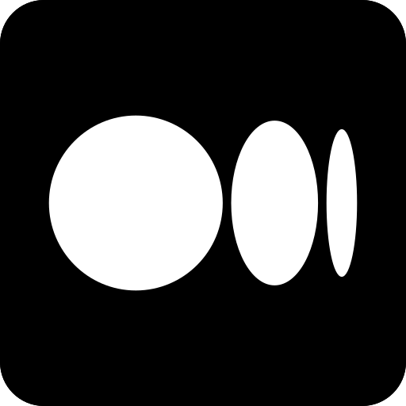
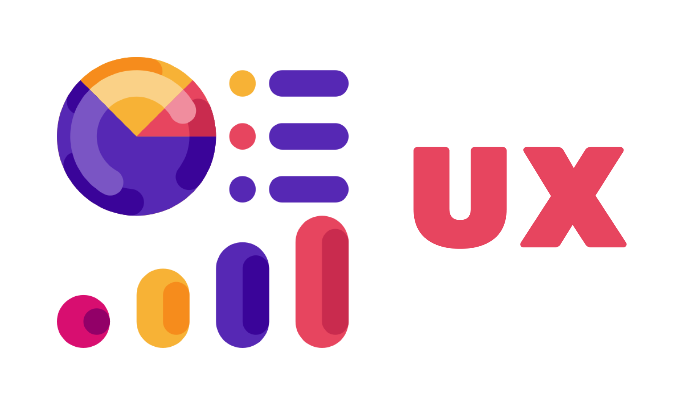
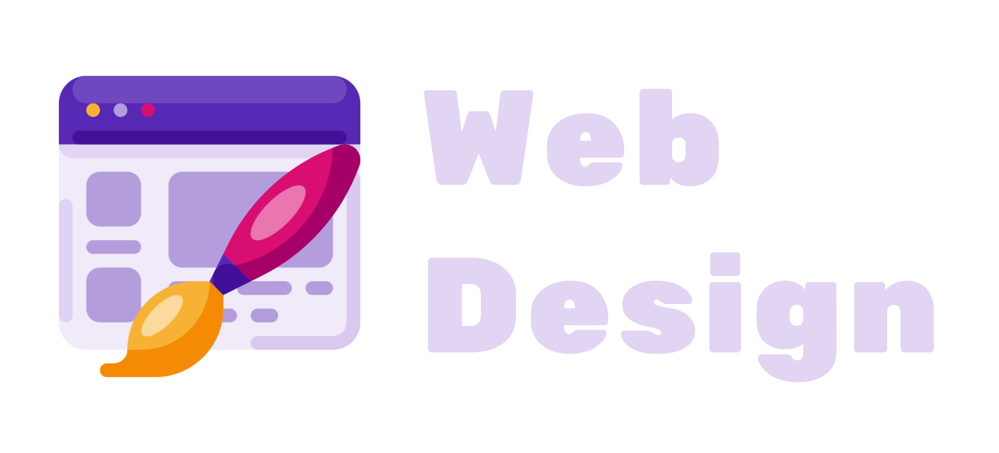
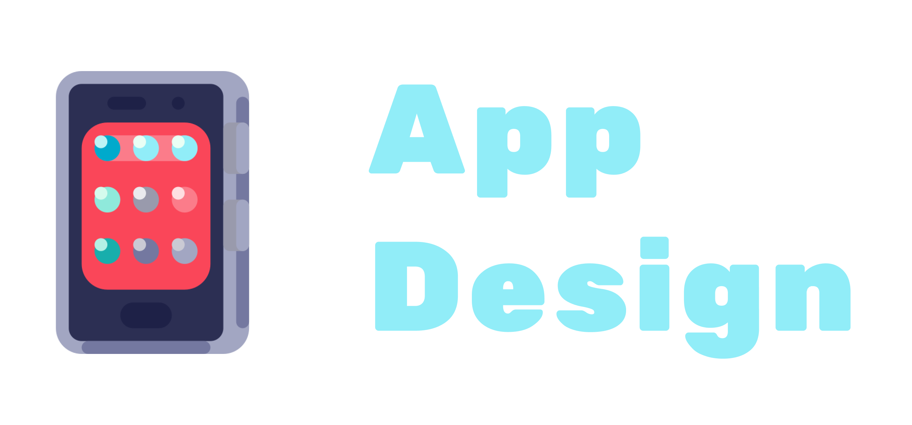
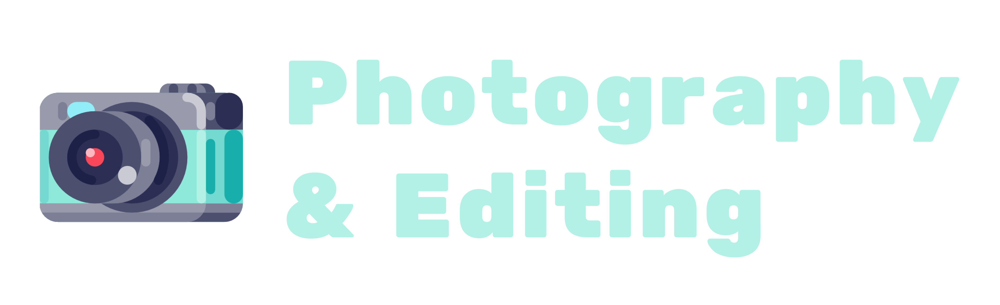
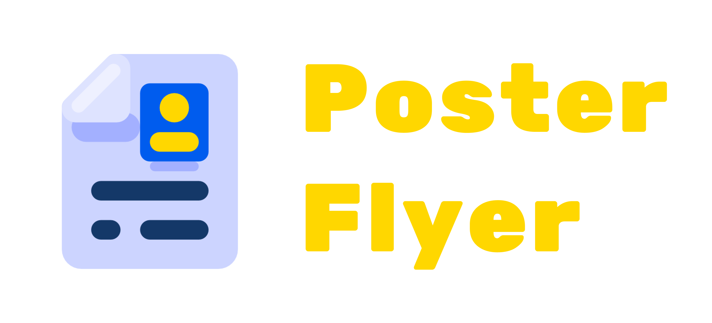
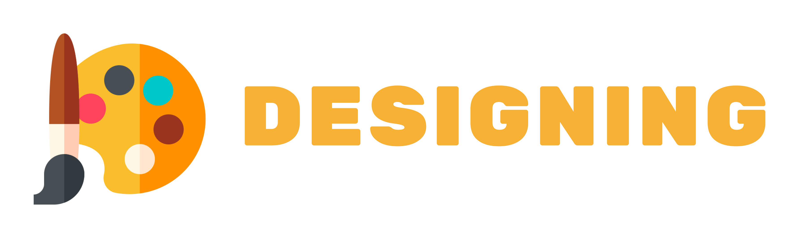
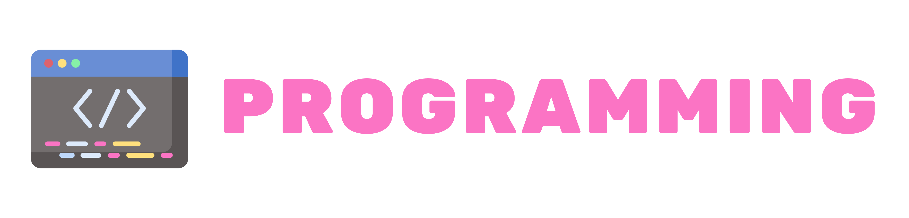
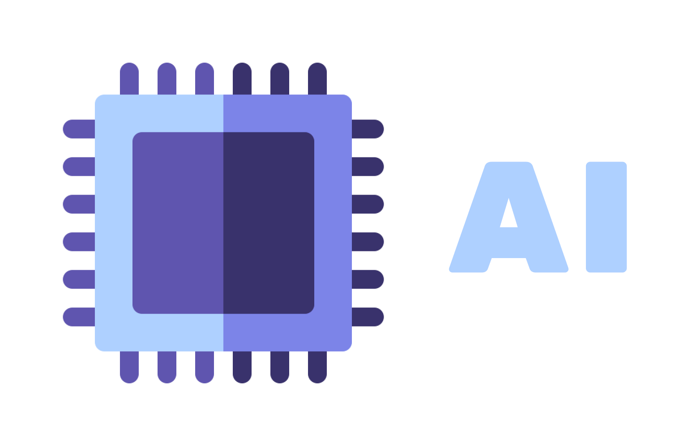
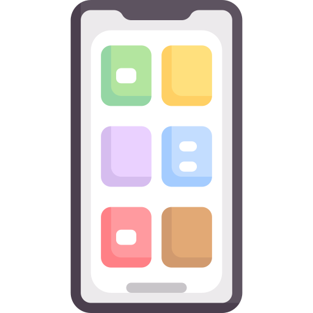

  

  &nbsp;&nbsp;
  &nbsp;&nbsp;
  &nbsp;&nbsp;
  &nbsp;&nbsp;
  <!--  -->
  

&nbsp;
&nbsp;
&nbsp;

# ✦ About Me

**I design digital experiences with a strong focus on clarity, visual consistency, and how things feel in use. My work is rooted in UI/UX and brand thinking, where every interface is shaped to be simple, structured, and easy to navigate. I pay close attention to spacing, typography, and visual rhythm to make sure each product feels cohesive from end to end.**

**I work closely with early-stage ideas and growing products, shaping both the interface and the brand as they evolve. From defining visual direction to building scalable design systems, I focus on creating work that holds together across screens and touchpoints. Currently, I lead design and brand experience at Mergex, where I handle the overall direction of product design and ensure consistency across everything we build.**

 

## ✦ Areas of Interest

**Web Development , Full-Stack Development , AI & Vibe Coding & Open Source Contributions**

 

## ✦ Skills

**Development**

  &nbsp;&nbsp;
  &nbsp;&nbsp;
  &nbsp;&nbsp;
  &nbsp;&nbsp;
  &nbsp;&nbsp;
  &nbsp;&nbsp;
  &nbsp;&nbsp;
  &nbsp;&nbsp;

**Design**

    &nbsp;&nbsp;
    &nbsp;&nbsp;
    &nbsp;&nbsp;
    &nbsp;&nbsp;
   &nbsp;&nbsp; 
    &nbsp;&nbsp;

**Writing**

    &nbsp;&nbsp;
    &nbsp;&nbsp;
    &nbsp;&nbsp;

<!-- **Hardware Technician**

   &nbsp;&nbsp;
   &nbsp;&nbsp;
  

 -->

**Softwares and Tools Familier**

    &nbsp;&nbsp;
    &nbsp;&nbsp;
  <!--  &nbsp;&nbsp;
   &nbsp;&nbsp; -->
    &nbsp;&nbsp;
    &nbsp;&nbsp;
  

&nbsp;

**Practice Goes on and on.**

## ✦ Github Stats

<!-- 

&nbsp;&nbsp;
<!--  -->

## ✦ I'm a Designer & Developer

&nbsp;
&nbsp;
&nbsp;

  

  

<!---
rakeshkanna-rk/rakeshkanna-rk is a ✨ special ✨ repository because its `README.md` (this file) appears on your GitHub profile.
You can click the Preview link to take a look at your changes.
--->
